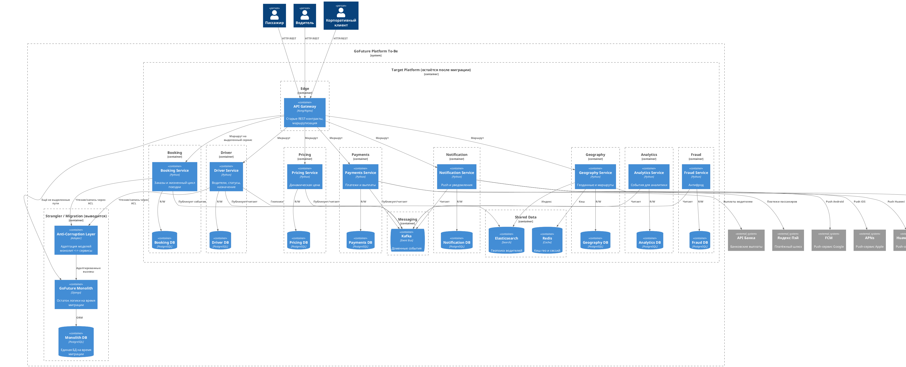

# Задание 1. Проектируем домены

**ADR-01: Декомпозиция монолита GoFuture на доменные сервисы**

**Дата:** 2026-10-22

## Контекст

- Монолит Django не выдерживает пики и тормозит вывод функций.
- Есть 8 продуктовых команд по доменам.
- Нужен поэтапный переход с минимумом простоя.

## Нефункциональные требования

| Категория          | Требование                                                       | Критичность |
| ------------------ | ---------------------------------------------------------------- | ----------- |
| Производительность | 500 тысяч конкурентных поездок                                   | Высокая     |
| Масштабирование    | Горизонтальное масштабирование более чем в 3 регионах            | Высокая     |
| Доступность        | 99,95% для критических сервисов                                  | Высокая     |
| Скорость поставки  | Новая функция за 2 недели                                        | Высокая     |
| Ценообразование    | Динамическая цена в реальном времени                             | Высокая     |
| Регуляторика       | Соответствие локальным требованиям (в т.ч. резидентность данных) | Высокая     |
| Интеграции         | Локальные платёжные и картографические сервисы                   | Средняя     |

## Доменные границы сервисов

- Домены по DDD совпадают с командами: Booking, Driver, Pricing, Payments, Notification, Geography, Analytics, Fraud.
- У каждого сервиса своя PostgreSQL.

## Очерёдность выделения сервисов

Логика: сначала слабо связанные и асинхронные части, ядро заказа - в конце (Strangler Fig, без "большого взрыва").

| #   | Сервис       | Обоснование                                            |
| --- | ------------ | ------------------------------------------------------ |
| 1   | Notification | Асинхронный, мало зависимостей, быстрый выигрыш        |
| 2   | Geography    | Геопоиск и карты, чёткая граница                       |
| 3   | Analytics    | Чтение событий, не на критическом пути заказа          |
| 4   | Fraud        | Событийный контур, можно подключать параллельно        |
| 5   | Pricing      | Нужен для динамической цены, зависит от событий спроса |
| 6   | Driver       | Локации и назначение, высокая нагрузка                 |
| 7   | Payments     | Деньги и внешние шлюзы                                 |
| 8   | Booking      | Последним: держит синхронный путь создания поездки     |

## Диаграмма C2 To-Be

[c2-to-be.puml](c2-to-be.puml) / [c2-to-be.png](c2-to-be.png)

## Механизмы обеспечения обратной совместимости

- API Gateway сохраняет текущие REST-контракты клиентов.
- Anti-Corruption Layer (ACL) адаптирует модели между монолитом и новым сервисом.
- Откат: маршрут на Gateway возвращается на монолит.

## План миграции данных на каждый сервис

1. Создать схему сервиса и API.
2. Начальная заливка истории пакетом (Airflow).
3. Чтение через ACL из монолита, запись в монолит.
4. Двойная запись (монолит + сервис) через Transactional Outbox.
5. Переключить чтение на сервис, затем запись.
6. Убрать таблицы монолита после срока хранения и проверки.

Пользователи остаются на старом API - простой минимален.

## Альтернативы

| Вариант                      | Плюсы                               | Минусы                                       | Почему не выбран                                   |
| ---------------------------- | ----------------------------------- | -------------------------------------------- | -------------------------------------------------- |
| Большой взрыв (всё сразу)    | Короче календарный план "на бумаге" | Долгий простой, риск потери данных, стоп фич | Анти-паттерн; не стыкуется с минимумом простоя     |
| Общая БД, schema-per-service | Быстрый старт выделения             | Нет изоляции нагрузки и отказов              | Не закрывает NFR по масштабу и доступности         |
| Выделять Booking первым      | Быстрее разгрузить ядро             | Высокая связанность, сложный cutover         | Слишком рискованно на старте миграции              |
| BFF на каждый клиент         | Удобные контракты под UI            | Лишний hop и дублирование логики             | Достаточно API Gateway со старыми REST-контрактами |

## Компромиссы

**Ограничения**

- Миграция растянута до года: Booking дольше всех остаётся в монолите.
- Пока жив Strangler - двойная запись, ACL и два контура данных.
- Своя БД на сервис удорожает ops и бэкапы.

**Риски**

- Рассинхрон при двойной записи - нужен outbox, сверки и идемпотентность.
- Ошибка cutover чтения/записи - откат маршрутом на Gateway, но возможен краткий дефект данных.
- Неверные границы доменов - дорого чинить после выделения; смягчается совпадением с командами и ACL.
- Нагрузка на монолит до выделения Booking/Payments - пики частично остаются до финальных этапов.
