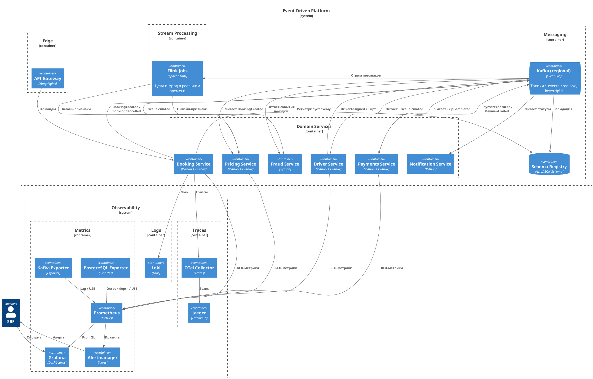

# Задание 2. Проектируем Event-Driven архитектуру

**ADR-2: Event-Driven платформа GoFuture**

**Дата:** 2026-10-23

## Контекст

- Нужно обрабатывать более 500 тысяч конкурентных поездок и динамическую цену в реальном времени.
- Требуется распределённая архитектура с возможностью обрабатывать события в реальном времени.

## Требования

- Модель доменных событий (BookingCreated, DriverLocationUpdated и др.).
- Топики Kafka с партиционированием по регионам.
- Потоковые потребители (Flink).
- Выбранный вид Saga и события.
- Надёжная доставка.
- Мониторинг: подход, метрики, инструменты на схеме.

## Решение

### Брокер и топики

- Региональный кластер Kafka (не один глобальный).
- Топик на домен и регион.
- Ключ `tripId` для поездки.

### Saga: Anthology

- Асинхронная хореография, итоговая согласованность.
- Линейный конвейер поездки, высокая пропускная способность, без оркестратора на горячем пути.

События:

| Событие          | Продюсер | Потребители                    |
| ---------------- | -------- | ------------------------------ |
| BookingCreated   | Booking  | Pricing, Fraud, Analytics      |
| PriceCalculated  | Pricing  | Booking, Driver                |
| DriverAssigned   | Driver   | Booking, Notification, Fraud   |
| TripStarted      | Driver   | Booking, Pricing, Analytics    |
| TripCompleted    | Driver   | Payments, Booking, Analytics   |
| PaymentCaptured  | Payments | Booking, Notification          |
| PaymentFailed    | Payments | Booking, Driver (компенсация)  |
| DriverReleased   | Driver   | Booking                        |
| BookingCancelled | Booking  | Driver, Payments, Notification |

### Надёжная доставка

- Transactional Outbox в БД сервиса + polling publisher.
- At-least-once в Kafka.
- Идемпотентные потребители.

### Потоковая обработка

- Flink читает топики для онлайн-признаков цены и фрода.
- KStreams не используем: Flink уже в ландшафте.

### Диаграмма C2

[c2-events.puml](c2-events.puml) / [c2-events.png](c2-events.png)

### Мониторинг

| Подход                                | Где               | Зачем                                |
| ------------------------------------- | ----------------- | ------------------------------------ |
| RED (rate, errors, duration)          | Доменные сервисы  | Пользовательский путь                |
| USE (utilization, saturation, errors) | Kafka, PostgreSQL | Ресурсы и очереди                    |
| Четыре золотых сигнала                | API Gateway       | Latency, traffic, errors, saturation |

Метрики:

- Consumer lag по топикам.
- Глубина outbox-таблицы.
- Время от BookingCreated до терминального события.
- Доля компенсаций (PaymentFailed / BookingCancelled).
- Ошибки реплик и утилизация диска брокера.

Инструменты:

- Prometheus
- Grafana
- Alertmanager
- Loki
- Kafka Exporter
- PostgreSQL Exporter
- OpenTelemetry Collector
- Jaeger

## Альтернативы

| Вариант                     | Плюсы                   | Минусы                          | Почему отклонён                   |
| --------------------------- | ----------------------- | ------------------------------- | --------------------------------- |
| Parallel Saga (оркестратор) | Управляемость ветвлений | Узкое место на 500k поездок     | Для линейного конвейера избыточно |
| Оставить RabbitMQ           | Уже есть                | Слабее для стриминга и партиций | Не тянет целевую нагрузку         |
| KStreams вместо Flink       | Ближе к Kafka           | Дублирует стек                  | Flink уже используется            |

## Компромиссы

- Без оркестратора сложнее трассировать сагу - нужен Jaeger.
- Eventual consistency: клиент может кратко видеть промежуточные статусы.
- Outbox + polling добавляет задержку миллисекундного порядка.
