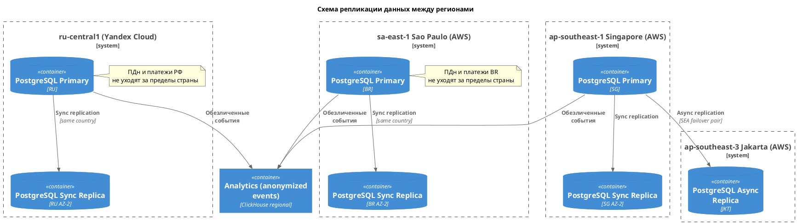
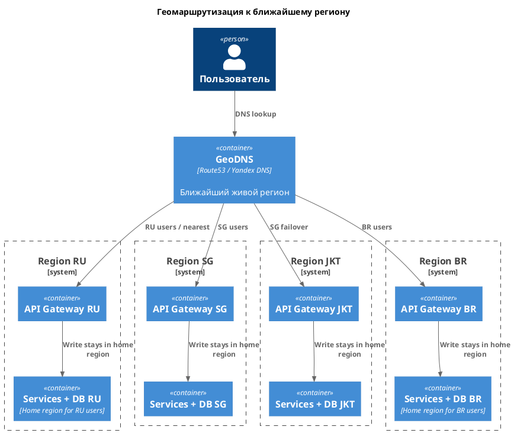
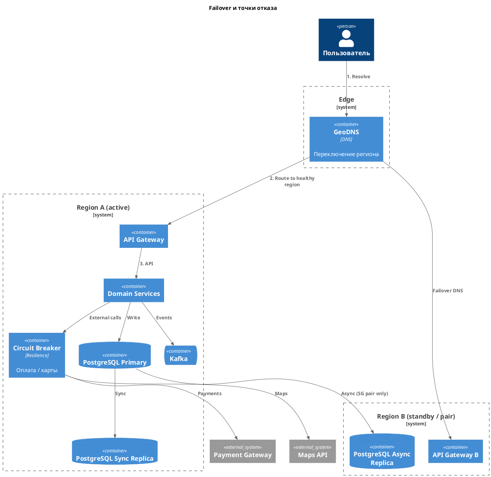
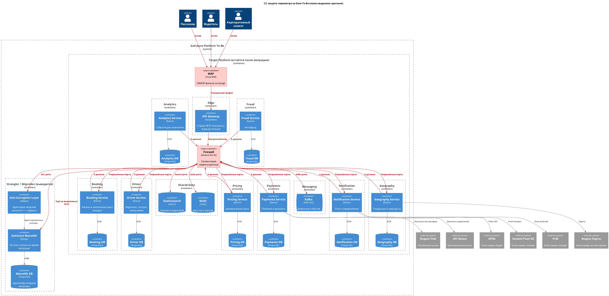

# Задание 3. Обеспечиваем высокую нагрузку

**ADR-03: Глобальное развёртывание**
 
**Дата:** 2026-10-26

## Контекст

- Нужна высокая доступность и низкая задержка для пользователей в Юго-Восточной Азии (ЮВА) и Южной Америке.
- 99,99% доступности через развёртывание более чем в трёх регионах.
- Плюс комплаенс.

## Требования

- Выбор регионов с обоснованием.
- Схема репликации.
- Геомаршрутизация.
- Аварийное переключение (C4) и таблица сценариев отказа.
- Стратегия комплаенса.
- WAF и Firewall на ландшафте.

## Решение

### Выбор регионов

| Регион                      | Облако       | Зачем                                  |
| --------------------------- | ------------ | -------------------------------------- |
| `ru-central1`               | Yandex Cloud | Текущий рынок, 152-ФЗ, домашний регион |
| `ap-southeast-1` (Сингапур) | AWS          | ЮВА                                    |
| `ap-southeast-3` (Джакарта) | AWS          | failover внутри ЮВА                    |
| `sa-east-1` (Сан-Паулу)     | AWS          | Южная Америка                          |

- Домашний рынок остаётся в Yandex Cloud.
- Три региона роста - в AWS: в кейсе уже есть EC2/ELB, у Yandex Cloud нет площадок в ЮВА и Южной Америке.

### Репликация

- Владелец данных - домашний регион пользователя.
- Синхронная реплика PostgreSQL во второй зоне того же региона.
- Асинхронная реплика только в паре Сингапур-Джакарта.
- ПДн и платёжные данные РФ и Бразилии за пределы страны не реплицируются.
- В аналитику уходят обезличенные события.

Схема: [replication.puml](replication.puml) / [replication.png](replication.png)

### Геомаршрутизация

- GeoDNS направляет клиента на ближайший живой региональный API Gateway.
- Запись поездки остаётся в домашнем регионе пользователя.

Схема: [geo-routing.puml](geo-routing.puml) / [geo-routing.png](geo-routing.png)

### Failover

- Точки отказа: зона, регион, primary БД, Kafka, внешние оплата и карты.  
- Механизмы: промоут реплики, переключение GeoDNS, circuit breaker, bulkhead по регионам.

Схема: [c4-failover.puml](c4-failover.puml) / [c4-failover.png](c4-failover.png)

| Сценарий                   | Что видит пользователь | Действие                                |
| -------------------------- | ---------------------- | --------------------------------------- |
| Падение зоны AZ            | Краткая деградация     | Промоут standby в соседней AZ           |
| Падение региона ЮВА (SG)   | Рост latency           | GeoDNS на Джакарту, async replica       |
| Падение primary PostgreSQL | Ошибки записи          | Automatic failover на sync replica      |
| Падение Kafka-брокера      | Задержка событий       | ISR, переизбрание лидера партиции       |
| Недоступен платёжный шлюз  | Оплата не проходит     | Circuit breaker, ретраи, очередь выплат |
| Недоступны карты           | Нет ETA/маршрута       | Кеш Redis/ES, degraded mode             |

### Комплаенс

- Данные и логи остаются в стране пользователя.
- Локальный платёжный провайдер в регионе.
- Шифрование данных и каналов.

### WAF и Firewall

На ландшафте (красным):

- **WAF** перед API Gateway - фильтрация OWASP-атак на публичный вход.
- **Firewall** между границей, сервисами и данными - сегментация сети, только разрешённые порты.

Ландшафт не расширяем набором других средств: эти два контура закрывают внешние атаки и боковое перемещение.

Схема: [c2-security.puml](c2-security.puml) / [c2-security.png](c2-security.png)

