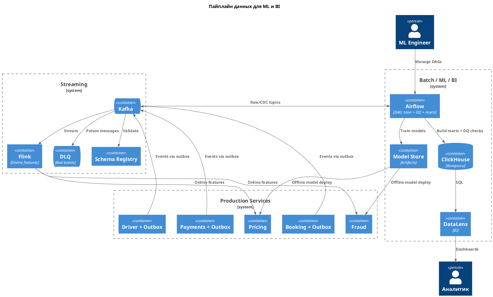

# Задание 4. Проектируем систему мониторинга

**ADR-04: Пайплайн данных для ML и BI**

**Дата:** 2026-10-27

## Контекст

- Нужна единая платформа сбора и анализа данных для ML (динамическая цена, прогноз спроса, фрод) и BI.
- Продсервисы нельзя нагружать аналитическими запросами.

## Требования

- Пайплайн от микросервисов до ML и BI.
- Механизмы качества данных.

## Решение

### Пайплайн

1. Сервисы пишут бизнес-изменение и событие в outbox одной транзакцией.
2. Publisher отправляет события в региональный Kafka.
3. **Flink** считает онлайн-признаки для Pricing и Fraud.
4. **Airflow** по расписанию: обучает модели, готовит витрины в ClickHouse.
5. **DataLens** читает витрины для BI.

Продсервисы аналитикой не читаются напрямую.

Схема: [c2-data-pipeline.puml](c2-data-pipeline.puml) / [c2-data-pipeline.png](c2-data-pipeline.png)

### Качество данных

| Механизм                     | Назначение                                  |
| ---------------------------- | ------------------------------------------- |
| Schema Registry              | Контракт события, запрет несовместимых схем |
| Идемпотентность по `eventId` | Нет дублей при at-least-once                |
| DLQ                          | Битые сообщения не блокируют поток          |
| Airflow checks               | Полнота, null-поля, свежесть витрин         |

Отдельный продукт качества данных не вводим - достаточно контракта, DLQ и проверок в DAG.

## Альтернативы

| Вариант                | Плюсы         | Минусы                  | Почему отклонён   |
| ---------------------- | ------------- | ----------------------- | ----------------- |
| Только batch без Flink | Проще         | Нет realtime цены/фрода | Не закрывает кейс |
| Запросы в прод-БД      | Быстрый старт | Деградация прод         | Анти-паттерн      |
| Отдельный DQ-продукт   | Богатый UI    | Лишняя сложность        | Избыточно         |

## Компромиссы

- Два контура (stream + batch) сложнее одного.
- Schema evolution требует дисциплины команд.
- Задержка batch-витрин - до окна расписания Airflow.
