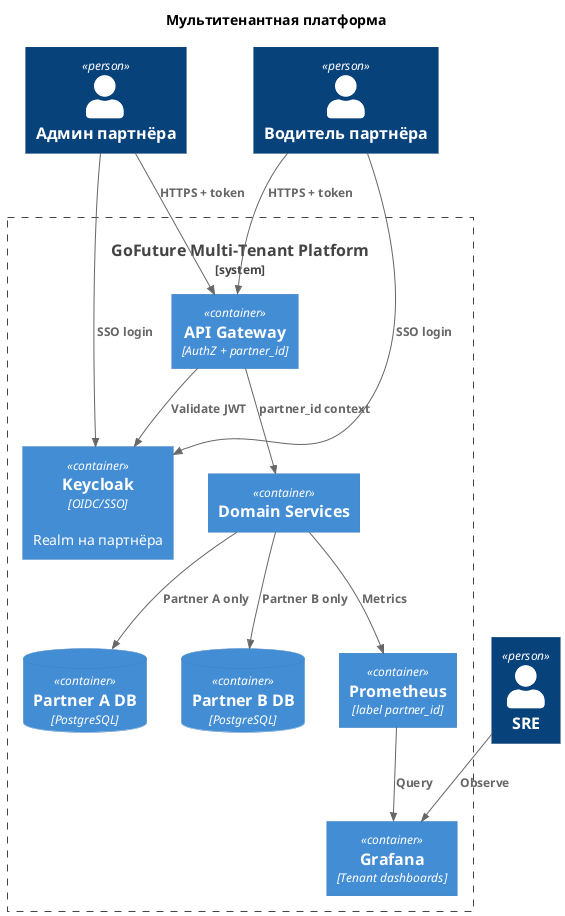
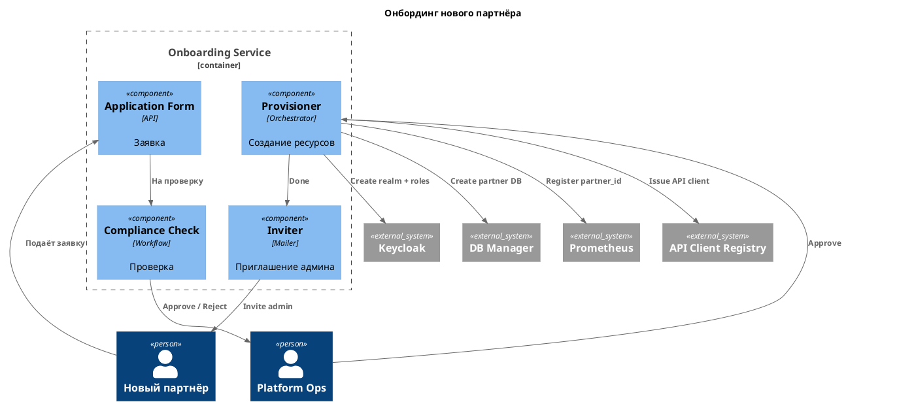

# Задание 5. Проектируем систему мониторинга

**ADR-05: Мультитенантная платформа**

**Дата:** 2026-10-28

## Контекст

- Нужен быстрый запуск партнёров в новых регионах с изоляцией данных и кастомизацией.

## Требования

- Модель изоляции данных.
- IAM с ролевым доступом и SSO.
- Автоматизированный онбординг.
- Мониторинг мультитенантного окружения.
- Таблица ролей и уровней доступа.

## Решение

### Изоляция

Отдельная PostgreSQL (или схема+кластер) на партнёра в региональном контуре.

### IAM

- Keycloak: OIDC, SSO, realm на партнёра.
- API Gateway проверяет токен и прокидывает `partner_id` в сервисы.

### Схема мультитенантной платформы

[c2-tenant.puml](c2-tenant.puml) / [c2-tenant.png](c2-tenant.png)

### Роли и доступ

| Роль                    | Данные своего партнёра           | Чужой партнёр | Платформенные настройки |
| ----------------------- | -------------------------------- | ------------- | ----------------------- |
| Администратор платформы | Да (все партнёры)                | Да            | Да                      |
| SRE                     | Метрики/логи всех (без ПДн в UI) | Метрики/логи  | Инфра                   |
| Администратор партнёра  | Полный CRUD в своём контуре      | Нет           | Нет                     |
| Диспетчер               | Поездки и водители партнёра      | Нет           | Нет                     |
| Водитель                | Свои поездки и выплаты           | Нет           | Нет                     |
| Пассажир                | Свои поездки и платежи           | Нет           | Нет                     |
| Аналитик партнёра       | Агрегаты своего партнёра в BI    | Нет           | Нет                     |

Мониторинг: Prometheus с label `partner_id`, Grafana-дашборды с фильтром по партнёру.

### Онбординг партнёра

1. Заявка партнёра.
2. Проверка комплаенса (Approve / Reject).
3. Создание realm и ролей в Keycloak.
4. Создание БД партнёра.
5. Выдача API-клиента.
6. Регистрация метрик (`partner_id`) в Prometheus.
7. Приглашение администратора партнёра.

Схема: [c3-onboarding.puml](c3-onboarding.puml) / [c3-onboarding.png](c3-onboarding.png)

## Альтернативы

| Вариант                           | Плюсы             | Минусы                                  | Почему отклонён             |
| --------------------------------- | ----------------- | --------------------------------------- | --------------------------- |
| Одна БД с полем partner_id        | Дешевле           | Утечки между партнёрами, общая нагрузка | Нет жёсткой изоляции данных |
| Отдельный кластер K8s на партнёра | Максимум изоляции | Дорого на старте                        | Избыточно для MVP партнёров |

## Компромиссы

- Больше БД - выше стоимость и операционная нагрузка.
- Realm на партнёра усложняет Keycloak ops.
- SRE видит метрики всех партнёров - нужен контроль доступа к сырым логам с ПДн.
